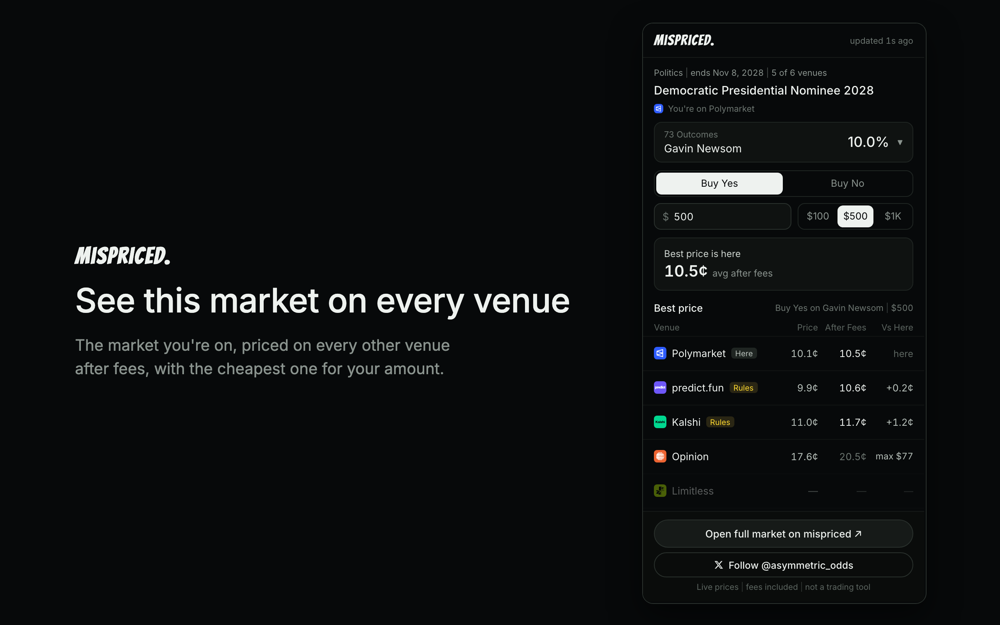

# Mispriced for Chrome

See the prediction market you're on priced on every other venue, after fees.

[](https://github.com/elbrys22/mispriced-extension/releases/latest)
[](https://x.com/asymmetric_odds)



**[Download the extension](https://github.com/elbrys22/mispriced-extension/releases/latest/download/mispriced-extension.zip)**, then follow [Install](#install).

Open a market on Polymarket, Kalshi, Limitless, Opinion, predict.fun, Hyperliquid (or Outcome) or XO, and the side
panel shows the same market on every other venue that lists it, with each venue's average price
after its fee for the amount you choose.

It only shows prices. It places no orders, connects no wallet or account, and its venue links carry
no referral codes.

## Features

- **Side panel:** price, price after fees and the difference to the venue you're on, for every
  venue, for any amount. Buy Yes or Buy No, every outcome of multi-outcome markets.
- **Follows your pick:** click an outcome on the venue's page and the panel switches to it.
- **Rules check:** warns when a venue words the market's rules differently.
- **Toolbar badge:** how much cheaper the market is elsewhere after fees, at a glance.
- **Settings:** default amount, which venues to compare, badge and panel options.
- **Update notices:** the panel tells you when a new version is out.

## Requirements

Google Chrome 116 or newer, on Windows, macOS or Linux. Other Chromium browsers may work but aren't
tested.

## Install

1. **[Download mispriced-extension.zip](https://github.com/elbrys22/mispriced-extension/releases/latest/download/mispriced-extension.zip)**
   (the latest version) and unzip it. Don't use GitHub's green **Code → Download ZIP** button:
   that's the source code, and Chrome can't load it.
2. Open `chrome://extensions` and switch on **Developer mode** (top right).
3. Click **Load unpacked** and pick the unzipped folder.
4. Pin Mispriced to the toolbar, open a market on any venue, click the icon and open the side panel
   (or press Alt+Shift+M).
5. Click **Allow and show prices** in the panel.

Keep the folder where it is: Chrome runs the extension from it.

## Update

When a new version is out, the panel shows "Version x.y.z is out". Download the
[latest zip](https://github.com/elbrys22/mispriced-extension/releases/latest/download/mispriced-extension.zip), unzip it
over the old folder, then press the reload arrow on Mispriced's card in `chrome://extensions`. Your
settings stay. Every version is listed under [Releases](https://github.com/elbrys22/mispriced-extension/releases).

## Only install it from here

The only official sources are this repository's releases and links on
[mispriced.fi](https://mispriced.fi). A copy from anywhere else may have been changed.

## Permissions

| Permission | Why |
| --- | --- |
| `sidePanel` | Shows the comparison beside the page. |
| `storage` | Keeps your settings and the market found for each open tab. |
| `alarms` | Refreshes the toolbar badge once a minute. |
| The venue sites (and Outcome, which shows Hyperliquid's markets) | Reads the link of the market page you have open, and which outcome you click on it. |
| `live.mispriced.fi` | Our server: finds the same market on the other venues and streams their public prices. |

## Privacy

Nothing is sent until you allow it in the panel. After that, only the link of the venue market page
you have open goes to our server, which answers with that market's public prices on the other
venues. Nothing about you, your accounts, wallet or browsing history is sent, and the outcome you
click never leaves your browser. There are no analytics in the extension. Full policy:
[mispriced.fi/privacy](https://mispriced.fi/privacy).

## FAQ

**Chrome warns about "developer mode extensions". Is that a problem?**
No. Chrome shows it for every extension installed from a folder rather than a store. Mispriced isn't
in the Chrome Web Store, so this is how it installs.

**Chrome says "Manifest file is missing or unreadable".**
You loaded the source code (a folder named `mispriced-extension-main`). Download
[mispriced-extension.zip](https://github.com/elbrys22/mispriced-extension/releases/latest/download/mispriced-extension.zip)
instead, unzip it and load that folder.

**The panel stays empty after an update.**
Reload the venue's tab once: Chrome only adds the updated extension to pages opened after the reload.

**The panel says "Update Mispriced to see prices".**
That version is too old for our server. Download the latest release and reload the extension.

**Does it work on mobile?**
No. Chrome on phones doesn't run extensions.

## Build it yourself

```bash
npm install
npm run build
```

`dist/` is the extension: load it with **Load unpacked**. `npm run zip` also packs it,
`npm run check` typechecks.

- `src/`: the panel, popup, toolbar badge and the content script that follows the outcome you
  click on a venue page.
- `shared/`: the fee and order-book maths, shared with mispriced.fi.
- `static/`: manifest, pages, styles, icons.

## Feedback and support

Bugs and ideas: [open an issue](https://github.com/elbrys22/mispriced-extension/issues), write to
support@mispriced.fi, or reach us on [X](https://x.com/asymmetric_odds). Pull requests aren't
accepted (see the licence).

## Security

Found a security problem? Write to support@mispriced.fi rather than opening a public issue.

## Licence

[PolyForm Strict 1.0.0](LICENSE.md): you may read, build and use this code for any noncommercial
purpose. You may not change it, redistribute it or build other works from it. © 2026 Mispriced.
